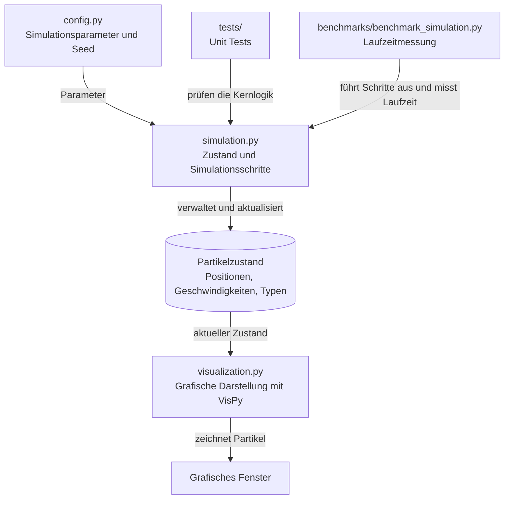
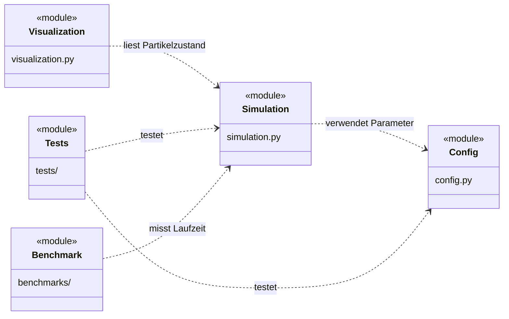

# Softwarearchitektur

## Überblick

Particle Life ist eine zweidimensionale Partikelsimulation. Die Architektur trennt die Berechnung des Simulationszustands von seiner grafischen Darstellung. Dadurch können Simulation, Tests und Benchmarks ohne grafisches Fenster ausgeführt werden.

## Architekturdiagramm

## UML-Komponentendiagramm

Das folgende UML-Diagramm zeigt die Komponenten der Anwendung und ihre Abhängigkeiten.

## Verantwortlichkeiten

| Komponente | Aufgabe |
|---|---|
| `config.py` | Verwaltet zentrale Parameter wie Partikelzahl, Interaktionsmatrix, Reichweite, Dämpfung, Zeitschritt und Seed. |
| `simulation.py` | Verwaltet Positionen, Geschwindigkeiten und Typen der Partikel. Berechnet Wechselwirkungen und aktualisiert den Zustand pro Simulationsschritt. |
| `visualization.py` | Liest den aktuellen Simulationszustand und stellt Partikel und ihre Bewegung grafisch dar. |
| `tests/` | Prüft die Konfiguration und die Simulationslogik ohne grafisches Fenster. |
| `benchmarks/benchmark_simulation.py` | Misst die Laufzeit von Simulationsschritten für verschiedene Partikelzahlen ohne grafisches Fenster. |

## Datenfluss

1. Die Konfiguration legt die Simulationsparameter und gegebenenfalls einen Zufalls-Seed fest.
2. Die Simulation initialisiert die Partikel mit Position, Geschwindigkeit und Typ.
3. Bei jedem Simulationsschritt berechnet die Simulation die Wechselwirkungen und aktualisiert Positionen und Geschwindigkeiten.
4. Die Visualisierung liest den aktuellen Zustand und zeichnet die Partikel. Sie berechnet keine Partikelkräfte.
5. Tests und Benchmarks greifen direkt auf die Simulationslogik zu. Sie benötigen keine Visualisierung.

## Zentrale Designentscheidungen

- **Trennung von Berechnung und Darstellung:** Die Simulation funktioniert unabhängig von der grafischen Oberfläche.
- **Zentrale Konfiguration:** Parameter werden nicht als verstreute feste Zahlen im Code gespeichert.
- **Reproduzierbarkeit:** Ein festgelegter Seed ermöglicht wiederholbare Initialisierungen.
- **Testbarkeit:** Die Kernlogik lässt sich ohne GUI testen.
- **Leistungsmessung:** Benchmarks messen Simulationsschritte unabhängig vom Rendering.
